# Especificação de Design — Módulo de Encomendas e Correspondências 100% Funcional

## 1. Visão Geral e Objetivos

O módulo de **Encomendas e Correspondências** da Zeladoria Condomínio conecta portaria, moradores e gestão condominial em um ciclo completo de recebimento, guarda, notificação, liberação segura por QR Code / PIN numérico e comprovação digital de entrega com auditoria.

### Regra Inegociável
- **Zero Operações Simuladas**: Todo botão, filtro, contador, QR Code, PIN de retirada, formulário, notificação e confirmação digital deve ser 100% real, integrado ao backend e persistido.
- **Preservação Visual**: Manter a identidade visual existente, padrão de componentes e paleta de cores institucional.
- **Segurança e Isolamento Multi-inquilino**: Garantir isolamento estrito por `condoId`, proteção de dados por RBAC (Portaria vs Morador vs Síndico) e anti-adivinhação de códigos.

---

## 2. Modelo de Dados e Ciclo de Vida da Encomenda

### 2.1 Estados da Encomenda

```mermaid
stateDiagram-v2
    [*] --> Pendente: Registro na Portaria (Gera ENC-XXXXX + PIN 6 dígitos + QR Code)
    Pendente --> Atrasada: Tempo de guarda > 7 dias (cálculo dinâmico baseado em receivedAt)
    Pendente --> Entregue: Portaria valida QR/PIN + confere documento + assina digitalmente
    Atrasada --> Entregue: Portaria valida QR/PIN + confere documento + assina digitalmente
    Entregue --> [*]: Credencial de retirada invalidada; Histórico auditável permanente
```

### 2.2 Entidade `parcels`
- `id` (bigint): Identificador primário interno.
- `condo_id` (bigint): Condomínio isolado.
- `unit_id` (bigint): Unidade de destino.
- `code` (string): Identificador único e sequencial no formato `ENC-XXXXX`.
- `kind` (string): Tipo de correspondência (`encomenda`, `correspondencia`, `delivery`).
- `carrier` (string): Transportadora (`Correios`, `Mercado Livre`, `Amazon`, `Shopee`, etc.).
- `tracking_code` (string): Código de rastreamento do pacote.
- `description` (text): Descrição física (ex: `Caixa média de papelão`).
- `shelf` (string): Local físico de armazenamento (ex: `Prateleira A2`, `Armário 1`, `Portaria`).
- `photo_url` (text): URL ou foto da encomenda.
- `status` (string): `pendente` ou `entregue`.
- `pickup_code` (string): PIN numérico aleatório de 6 dígitos (ex: `837587`).
- `received_by_id` (bigint): Usuário da portaria que registrou a entrada.
- `received_at` (timestamp): Data e hora exatas do recebimento.
- `picked_up_at` (timestamp): Data e hora exatas da entrega física.
- `picked_up_by` (string): Nome da pessoa que realizou a retirada.
- `picked_up_document` (string): Documento (RG/CPF) conferido pela portaria.
- `signature` (text): Nome completo ou rubrica digital coletada no ato da retirada.
- `notes` (text): Observações operacionais.

---

## 3. Arquitetura dos Fluxos Funcionais

### 3.1 Fluxo 1: Recebimento e Registro na Portaria
1. Portaria ou Síndico autenticado acessa o painel de encomendas.
2. Preenche o formulário de entrada: unidade destinatária (obrigatória), tipo de objeto, transportadora, rastreamento, descrição, local físico de armazenamento e foto opcional.
3. Submissão dispara `registerParcelAction`:
   - Valida `condoId` e existência da unidade.
   - Gera código sequencial estável `ENC-XXXXX`.
   - Gera PIN criptograficamente seguro de 6 dígitos.
   - Persiste registro no banco de dados.
   - Dispara notificação automática instantânea para todos os moradores da unidade:
     `Nova encomenda na portaria: [Transportadora] recebida. Código: [PIN]. Local: [Prateleira].`
   - Registra log de auditoria com IP, agente, timestamp e dados do operador.
   - Retorna `{ success: true, message, parcel }` e revalida rotas.

### 3.2 Fluxo 2: Visualização pelo Morador & QR Code
1. Morador autenticado acessa `/painel/encomendas`:
   - O backend filtra exclusivamente as encomendas da sua unidade (`unitId`).
   - Ações de portaria (registro de entrada e confirmação) não são exibidas.
2. Cada encomenda exibe seu identificador `ENC-XXXXX`, status, local onde está guardada e mini-QR Code.
3. Ao clicar no card ou no botão "Ver QR Code de Retirada", abre o **Modal de Retirada do Morador**:
   - QR Code em alta resolução gerado com payload protegido `ENC:[code]:[pickupCode]`.
   - PIN numérico de 6 dígitos em destaque com botão de copiar.
   - Local físico na portaria (ex: "Prateleira A2").
   - Informações da transportadora e botão de cópia do código de rastreamento.
   - Instruções de retirada: "Apresente este código na portaria acompanhado de um documento com foto."

### 3.3 Fluxo 3: Validação e Entrega na Portaria (Scanner / PIN)
1. Portaria clica em `[📷 Ler QR / Digitar Código]` ou no card da encomenda pendente.
2. Abre o **Modal Operacional de Validação e Entrega**:
   - **Entrada rápida**: Campo de texto aceita PIN de 6 dígitos, código `ENC-XXXXX`, rastreio ou leitura direta via leitor USB / pistola de código de barras.
   - **Leitor de Câmera**: Botão para ligar a câmera do dispositivo e fazer a leitura do QR Code em tempo real (`navigator.mediaDevices.getUserMedia`).
3. Ao identificar a encomenda:
   - Exibe dados detalhados para conferência visual: Bloco, Unidade, Destinatário, Local de guarda físico (ajudando o porteiro a pegar a caixa na prateleira correta), Transportadora e Descrição.
   - Se já estiver entregue: Alerta em tom vermelho com data, hora e quem retirou, bloqueando nova entrega.
   - Se pendente: Exibe formulário de confirmação digital:
     - Quem retirou (Nome).
     - Documento (RG / CPF).
     - Assinatura digital (Nome completo por extenso como termo).
     - Observações opcionais.
4. Ao clicar em "Confirmar Entrega Digital":
   - Dispara `deliverParcelAction`:
     - Proteção de concorrência: verifica se a encomenda ainda está `pendente`.
     - Valida `pickupCode`.
     - Atualiza status para `entregue`, gravando `pickedUpAt`, `pickedUpBy`, `pickedUpDocument`, `signature`.
     - Invalida a credencial de retirada (não permite reutilização).
     - Dispara notificação ao morador: `Encomenda [code] foi retirada por [quem].`
     - Registra evento de auditoria crítica.
     - Atualiza instantaneamente a interface e contadores.

---

## 4. Indicadores, Filtros e Busca

### 4.1 Indicadores (KPI Cards)
- **Aguardando retirada**: Total de encomendas pendentes (`status === 'pendente'`). Ao clicar, filtra a lista para pendentes.
- **Atrasadas (7+ dias)**: Total de encomendas pendentes com `receivedAt` anterior a 7 dias. Ao clicar, filtra para atrasadas.
- **Entregues**: Total de encomendas confirmadas (`status === 'entregue'`). Ao clicar, filtra para entregues.

### 4.2 Filtros e Busca em Tempo Real
- Abas tipo cápsula: `Todas`, `Aguardando retirada`, `Atrasadas`, `Entregues` sincronizadas com a URL (`?status=...`) e com o estado interativo.
- Campo de busca instantânea: Filtra no cliente e no servidor por código `ENC-...`, código de rastreio, unidade, morador ou transportadora.

---

## 5. Matriz de Permissões (RBAC)

| Perfil | Ver Encomendas | Registrar Encomenda | Validar QR/PIN | Confirmar Entrega | Ver Histórico Geral |
|---|---|---|---|---|---|
| **Morador** | Somente da própria unidade | ❌ Não | ❌ Não | ❌ Não | ❌ Somente da sua unidade |
| **Porteiro** | Todas do condomínio | ✅ Sim | ✅ Sim | ✅ Sim | ✅ Sim |
| **Zelador** | Todas do condomínio | ✅ Sim | ✅ Sim | ✅ Sim | ✅ Sim |
| **Síndico** | Todas do condomínio | ✅ Sim | ✅ Sim | ✅ Sim | ✅ Sim |
| **Superadmin** | Todas do condomínio | ✅ Sim | ✅ Sim | ✅ Sim | ✅ Sim |

---

## 6. Tratamento de Exceções e Resiliência
- **Código incorreto**: Alerta visual claro e log de auditoria de tentativa inválida.
- **Encomenda já entregue**: Bloqueio de entrega duplicada com mensagem informativa.
- **Unidade inexistente ou de outro condomínio**: Rejeição no servidor.
- **Concorrência**: Duas tentativas de retirada simultânea: a primeira consolida a entrega; a segunda é abortada com feedback de que a encomenda já foi retirada.
