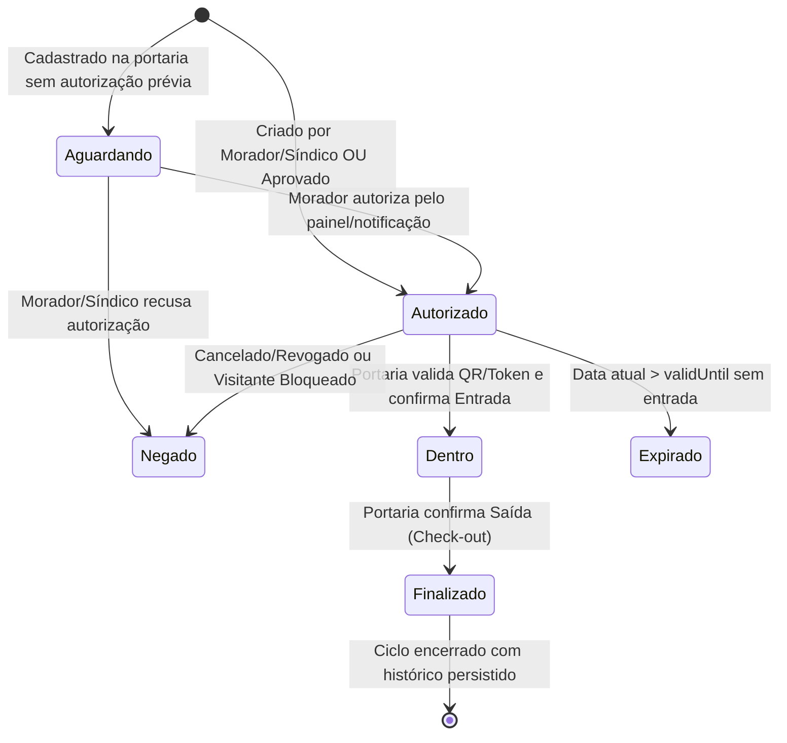

# Especificação de Design — Módulo de Visitantes e Prestadores 100% Funcional

## 1. Visão Geral e Objetivos

O módulo de **Visitantes e Prestadores** da Zeladoria Condomínio é a espinha dorsal da segurança de acesso físico, conectando moradores, portaria e administração.
Abrange todo o ciclo de vida do acesso:
1. Cadastro antecipado pelo morador (ou na chegada pela portaria).
2. Auto-preenchimento inteligente de visitantes e prestadores já cadastrados no condomínio.
3. Geração de convite seguro com token e QR Code exclusivo.
4. Compartilhamento do convite e página pública com visualização responsiva.
5. Validação na portaria por câmera em tempo real ou digitação/leitor USB.
6. Registro confiável de check-in (Entrada) e check-out (Saída).
7. Gestão de prestadores recorrentes e lista de bloqueios administrativos.
8. Histórico auditável com rastreamento completo e notificações instantâneas.

### Regra Inegociável
- **Zero Operações Simuladas**: Nenhum botão, filtro, contador ou QR code pode ser decorativo. Toda ação deve persistir no banco de dados e ter validação de segurança no servidor.
- **Preservação Visual**: Manter a identidade estética do sistema, com componentes refinados e conformidade estrita com a regra de Zero Gradientes Tailwind.

---

## 2. Ciclo de Estados da Visita

### Regras de Transição e Validação
1. **Autorizado -> Dentro**:
   - Apenas se `status === 'autorizado'`.
   - Data atual dentro do intervalo: `validFrom <= now <= validUntil`.
   - Visitante não pode estar na lista de bloqueios (`visitor.blocked === false`).
   - Registra `checkinAt` (data/hora do servidor) e `checkinById` (operador da portaria).
   - Dispara notificação imediata aos moradores da unidade: "Visitante entrou no condomínio".
2. **Dentro -> Finalizado**:
   - Apenas se `status === 'dentro'` (não permite saída sem entrada correspondente).
   - Registra `checkoutAt` e `checkoutById`.
   - Dispara notificação aos moradores da unidade: "Visitante saiu do condomínio".
3. **Bloqueio Administrativo**:
   - Se um visitante for bloqueado, qualquer visita futura ou pendente vinculada a ele tem o acesso imediatamente barrado na portaria com a justificativa registrada.

---

## 3. Arquitetura dos Fluxos Funcionais

### 3.1 Fluxo de Cadastro e Reutilização de Visitantes
- **Novo Cadastro**: Informa Nome, Documento, Tipo (`visitante`, `prestador`, `entrega`), Empresa (se prestador), Placa do veículo, Período de validade (`validFrom` a `validUntil`), Finalidade e flag de Recorrência.
- **Visitante já cadastrado**: Ao selecionar um visitante existente no dropdown, os campos reutilizáveis (Nome, Documento, Tipo, Empresa, Placa) são **automaticamente preenchidos** no formulário para acelerar o processo, permitindo que o morador apenas ajuste a data/hora e a finalidade.

### 3.2 Geração e Compartilhamento de Convite com QR Code
- Ao submeter o convite, o backend gera um `qrToken` seguro de 16 bytes base64url.
- O morador pode:
  - Visualizar o QR Code ampliado na tela.
  - Copiar o link seguro (`/v/[token]`).
  - Compartilhar via WhatsApp com mensagem formatada contendo o link do convite.
  - Revogar o convite antes do uso.

### 3.3 Validação e Operação da Portaria (Scanner / Token)
- Botão destacado no topo da tela: `[📷 Validar Convite (QR / Token)]`.
- Modal interativo com:
  - Entrada de texto para digitar o token, nome, documento ou bipar com leitor de código de barras.
  - Scanner de câmera em tempo real (`navigator.mediaDevices.getUserMedia`) com detecção visual.
  - Conferência prévia: Nome do visitante, Empresa, Placa, Unidade de destino, Anfitrião, Finalidade e Validade.
  - Botão de ação contextual:
    - Se `autorizado`: Botão verde "Registrar Entrada".
    - Se `dentro`: Botão escuro "Registrar Saída".
    - Se `aguardando`: Botão de decisão com autorização/recusa.
    - Se `bloqueado` ou `expirado`: Alerta vermelho bloqueando a entrada com justificativa clara.

---

## 4. Indicadores e Filtros Superiores

Abas tipo cápsula sincronizadas com o estado da aplicação e da URL (`?status=...`):
- **Todos**: Total de convites e visitas no escopo do usuário.
- **Aguardando**: Visitas pendentes de liberação do morador ou síndico.
- **Autorizados**: Visitas ativas prontas para entrada dentro da vigência.
- **No condomínio**: Visitantes que realizaram check-in e ainda não saíram.
- **Finalizados**: Visitas com entrada e saída concluídas.
- **Negados**: Visitas rejeitadas ou barradas por bloqueio.

---

## 5. Matriz de Permissões (RBAC)

| Perfil | Ver Visitas | Criar Convite | Autorizar/Negar | Registrar Entrada/Saída | Gerenciar Bloqueios |
|---|---|---|---|---|---|
| **Morador** | Somente da própria unidade | ✅ Sim (para sua unidade) | ✅ Sim (para sua unidade) | ❌ Não | ❌ Não |
| **Porteiro** | Todas do condomínio | ✅ Sim (aguarda morador) | ✅ Sim (se autorizado) | ✅ Sim | ✅ Sim |
| **Zelador** | Todas do condomínio | ✅ Sim | ✅ Sim | ✅ Sim | ✅ Sim |
| **Síndico** | Todas do condomínio | ✅ Sim | ✅ Sim | ✅ Sim | ✅ Sim |
| **Superadmin** | Todas do condomínio | ✅ Sim | ✅ Sim | ✅ Sim | ✅ Sim |
