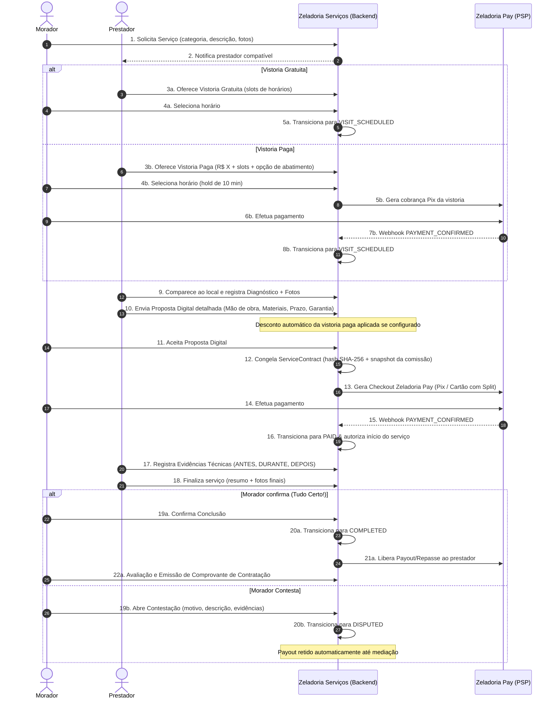

# Fluxo Operacional Completo do Zeladoria Serviços

## Fluxograma de Contratação

## Etapas Principais

1. **Solicitação de Serviço**: Morador relata a necessidade, adiciona fotos e endereço no condomínio.
2. **Definição da Vistoria**: O prestador avalia a complexidade e oferece vistoria gratuita ou técnica remunerada.
3. **Agendamento e Hold**: Vistorias pagas bloqueiam o horário por 10 minutos. O agendamento definitivo só é consolidado após confirmação do webhook do PSP.
4. **Diagnóstico Técnico**: Registro de causas, riscos identificados e lista de materiais necessários.
5. **Proposta Digital Itemizada**: Composição discriminada entre mão de obra, materiais, custos operacionais e abatimento da vistoria.
6. **Aceite e Contrato Imutável**: O morador aceita digitalmente, gerando contrato auditável com hash SHA-256.
7. **Checkout Zeladoria Pay**: Geração de Pix com QR Code dinâmico e código copia-e-cola via Asaas.
8. **Execução e Evidências**: Prestador anexa evidências com selo temporal em três estágios: ANTES, DURANTE e DEPOIS.
9. **Finalização e Confirmação**: Morador inspeciona a conclusão e tem duas opções: "Está tudo certo" (libera repasse) ou "Tenho um problema" (abre disputa).
10. **Pós-Serviço & Garantia**: Acompanhamento do prazo legal de garantia (mínimo 90 dias conforme CDC), emissão de comprovante e avaliação com critérios detalhados.
